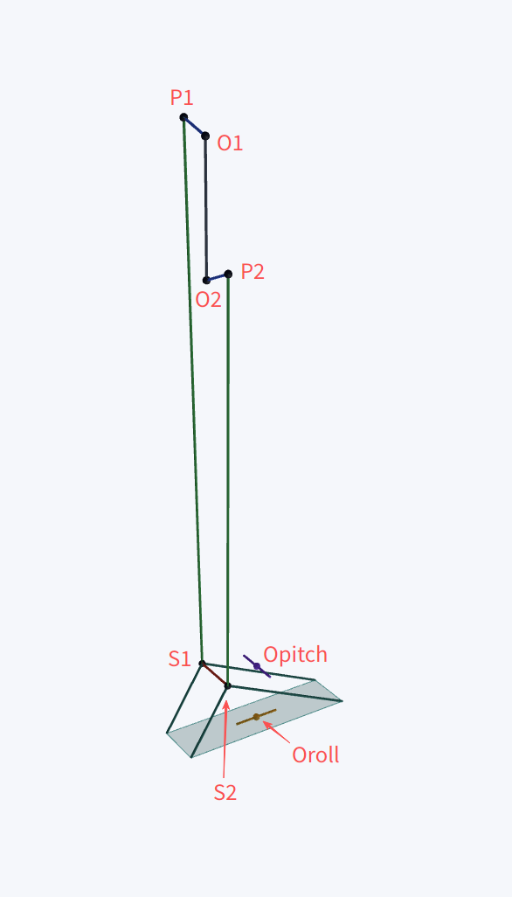

# 六连杆闭链机构运动学与低速准静态力学建模

## 1. 机构描述

该机构由以下部分组成：

1. 固定机架；
2. 两个输入转动副；
3. 两个平面输入连杆；
4. 两根空间连接杆；
5. 一个中间空间连杆。

其中：

- 两个输入转动副固定在机架上；
- 两个输入转动副的旋转轴平行；
- 输入转动副转轴均沿世界坐标系 $Z$ 轴；
- 两个输入平面连杆始终位于 $XY$ 平面；
- 中间空间连杆通过两根空间连接杆与输入平面连杆形成闭链；
- 中间空间连杆具有两个姿态自由度：roll 与 pitch；
- roll 旋转中心与 pitch 旋转中心不重合；
- pitch 与 roll 的旋转顺序不固定，需要同时支持：
  - `roll -> pitch`
  - `pitch -> roll`

本文仅考虑低速准静态情况，因此忽略：

- 惯性项；
- 科氏项；
- 离心项；
- 柔性变形；
- 高频振动。

因此：

- 速度通过闭链约束一阶导数得到；
- 力矩通过虚功关系得到。

---

## 2. 几何定义

### 2.1 世界坐标系

定义世界坐标系 $\{W\}: OXYZ$：

- 原点位于机架中心；
- $XY$ 平面为机构平面；
- $Z$ 轴为输入转动副旋转轴。

注意机构平面为一个抽象概念，本机构并不一定在同一平面内，仅与$Z$轴做区分

### 2.2 输入转动副

定义两个输入转动副中心为 $O_1$、$O_2$。

输入平面连杆零位末端点为 $P_1$、$P_2$。

定义零位向量：

- $v_1 = P_1 - O_1$
- $v_2 = P_2 - O_2$

输入角定义为：

$$
\theta =
\begin{bmatrix}
\theta_1 \\
\theta_2
\end{bmatrix}
$$

### 2.3 中间空间连杆

中间空间连杆零位连接点为 $S_1$、$S_2$。

定义：

- $O_{roll}$：roll 旋转中心；
- $O_{pitch}$：pitch 旋转中心。

注意：

$O_{roll}$可能不等于$O_{pitch}$，因此 pitch 与 roll 的旋转有可能不仅改变姿态，还会产生平移。

### 2.4 空间连接杆长度

定义：

$$
b_1 = ||P_1 - S_1||
$$

$$
b_2 = ||P_2 - S_2||
$$

### 2.5 roll / pitch 广义坐标

规范坐标系中，roll 轴取输入转动副旋转轴方向，pitch 轴取机构零位时的 $O_1 \rightarrow O_2$ 轴线方向，其符号定义如下：

$$
q =
\begin{bmatrix}
\phi \\
\psi
\end{bmatrix}
$$

其中：

- $\phi = roll$，正方向与电机旋转轴正方向一致，遵从右手定则
- $\psi = pitch$，正方向定义为 $O_1 \rightarrow O_2$ 方向

若输入中未显式提供 `rotate_direction`，则输入平面法向 / 默认旋转轴方向由

```text
(O1 - P1) x (O1 - O2)
```

确定；若显式提供了 `rotate_direction`，则以输入方向为准。

### 2.6 旋转顺序

定义两种旋转顺序：

- `RollThenPitch`
- `PitchThenRoll`

对应机构链分别为：

```text
base -> roll -> pitch -> middle link
base -> pitch -> roll -> middle link
```

### 2.7 绕空间任意点旋转

绕点 $O$、绕单位轴 $a$、旋转角 $\alpha$ 的刚体变换为：

$$
A(O,a,\alpha)=
\begin{bmatrix}
R(a,\alpha) & (I-R(a,\alpha))O \\
0 & 1
\end{bmatrix}
$$

对点 $X$ 有：

$$
X' = O + R(a,\alpha)(X-O)
$$

定义：

$$
A_r(\phi)=A(O_{roll},\hat x,\phi)
$$

$$
A_p(\psi)=A(O_{pitch},\hat y,\psi)
$$

### 2.8 中间空间连杆当前位姿

若采用 `roll -> pitch`：

$$
T = A_r(\phi) A_p(\psi)
$$

若采用 `pitch -> roll`：

$$
T = A_p(\psi) A_r(\phi)
$$

当前连接点：

$$
S_i(q)=T S_i
$$

其中：

$$
i \in \{1,2\}
$$



---

## 3. 约束方程推导

### 3.1 输入平面连杆当前末端点

输入平面连杆绕 $Z$ 轴转动。

定义 $R_z(\theta_i)$ 为绕 $Z$ 轴旋转矩阵，则：

$$
P_i(\theta_i)=O_i+R_z(\theta_i)v_i
$$

### 3.2 闭链约束

左右空间连接杆长度保持不变：

$$
||P_1(\theta_1)-S_1(q)||^2=b_1^2
$$

$$
||P_2(\theta_2)-S_2(q)||^2=b_2^2
$$

定义误差向量：

$$
e_i=P_i(\theta_i)-S_i(q)
$$

则：

$$
f_i=e_i^Te_i-b_i^2
$$

完整闭链约束：

$$
F(\theta,q)=
\begin{bmatrix}
f_1(\theta,q) \\
f_2(\theta,q)
\end{bmatrix}
=0
$$

### 3.3 闭链约束一阶导数

对时间求导：

$$
\frac{dF}{dt}=0
$$

得到：

$$
F_\theta \dot\theta + F_q \dot q = 0
$$

其中：

$$
F_\theta = \frac{\partial F}{\partial \theta}
$$

$$
F_q = \frac{\partial F}{\partial q}
$$

### 3.4 输入角雅可比

由于：

$$
f_i=e_i^Te_i-b_i^2
$$

因此：

$$
\frac{\partial f_i}{\partial \theta_i}
=
2 e_i^T
\left(
\frac{\partial P_i}{\partial \theta_i}
\right)
$$

平面杆末端导数：

$$
\frac{\partial P_i}{\partial \theta_i}
=
\hat z \times (P_i-O_i)
$$

因此：

$$
F_\theta=
\mathrm{diag}
\left(
2 e_1^T[\hat z \times (P_1-O_1)],
2 e_2^T[\hat z \times (P_2-O_2)]
\right)
$$

### 3.5 roll / pitch 雅可比

由于：

$$
e_i=P_i-S_i
$$

因此：

$$
\frac{\partial f_i}{\partial q_j}
=
-2 e_i^T
\left(
\frac{\partial S_i}{\partial q_j}
\right)
$$

于是：

$$
F_q=
\left[
\frac{\partial f_i}{\partial q_j}
\right]
$$

### 3.6 刚体变换导数

对于：

$$
A(O,a,\alpha)=
\begin{bmatrix}
R & (I-R)O \\
0 & 1
\end{bmatrix}
$$

有：

$$
\frac{\partial A}{\partial \alpha}
=
\begin{bmatrix}
\frac{\partial R}{\partial \alpha}
&
-\left(
\frac{\partial R}{\partial \alpha}
\right) O \\
0 & 0
\end{bmatrix}
$$

定义：

$$
\dot A_r = \frac{\partial A_r}{\partial \phi}
$$

$$
\dot A_p = \frac{\partial A_p}{\partial \psi}
$$

若采用 `roll -> pitch`：

$$
T=A_r A_p
$$

$$
\frac{\partial T}{\partial \phi}
=
\dot A_r A_p
$$

$$
\frac{\partial T}{\partial \psi}
=
A_r \dot A_p
$$

若采用 `pitch -> roll`：

$$
T=A_p A_r
$$

$$
\frac{\partial T}{\partial \phi}
=
A_p \dot A_r
$$

$$
\frac{\partial T}{\partial \psi}
=
\dot A_p A_r
$$

于是：

$$
\frac{\partial S_i}{\partial \phi}
=
\left[
\left(
\frac{\partial T}{\partial \phi}
\right)
S_i
\right]_{xyz}
$$

$$
\frac{\partial S_i}{\partial \psi}
=
\left[
\left(
\frac{\partial T}{\partial \psi}
\right)
S_i
\right]_{xyz}
$$

---

## 4. 正运动学

### 4.1 位置正解

已知输入角：

$$
\theta =
\begin{bmatrix}
\theta_1 \\
\theta_2
\end{bmatrix}
$$

求：

$$
q =
\begin{bmatrix}
\phi \\
\psi
\end{bmatrix}
$$

求解：

$$
F(\theta,q)=0
$$

即：

$$
\begin{bmatrix}
||P_1(\theta_1)-S_1(q)||^2-b_1^2 \\
||P_2(\theta_2)-S_2(q)||^2-b_2^2
\end{bmatrix}
=0
$$

### 4.2 Newton 迭代

定义当前估计：

$$
q_k =
\begin{bmatrix}
\phi_k \\
\psi_k
\end{bmatrix}
$$

Newton 迭代：

$$
F_q(q_k)\Delta q = -F(q_k)
$$

更新：

$$
q_{k+1}=q_k+\Delta q
$$

推荐使用：

- Newton；
- LM；
- 阻尼最小二乘。

### 4.3 位姿输出

当前中间空间连杆位姿为：

$$
T(q)=A_r(\phi)A_p(\psi)
$$

或：

$$
T(q)=A_p(\psi)A_r(\phi)
$$

### 4.4 速度正解

由闭链速度约束：

$$
F_\theta \dot\theta + F_q \dot q = 0
$$

得到：

$$
\dot q = -F_q^{-1} F_\theta \dot\theta
$$

定义速度雅可比：

$$
J_{q\theta}=-F_q^{-1}F_\theta
$$

则：

$$
\dot q = J_{q\theta}\dot\theta
$$

即：

$$
\begin{bmatrix}
\dot\phi \\
\dot\psi
\end{bmatrix}
=
J_{q\theta}
\begin{bmatrix}
\dot\theta_1 \\
\dot\theta_2
\end{bmatrix}
$$

### 4.5 力矩正解

低速准静态下：

$$
\tau_\theta^T \dot\theta
=
\tau_q^T \dot q
$$

因此：

$$
\tau_q = J_{q\theta}^{-T}\tau_\theta
$$

即：

$$
\begin{bmatrix}
\tau_{roll} \\
\tau_{pitch}
\end{bmatrix}
=
J_{q\theta}^{-T}
\begin{bmatrix}
\tau_{\theta1} \\
\tau_{\theta2}
\end{bmatrix}
$$

工程实现中不建议显式求逆，应直接解线性方程：

$$
J_{q\theta}^T \tau_q = \tau_\theta
$$

---

## 5. 逆运动学

### 5.1 位置逆解

已知：

$$
q =
\begin{bmatrix}
\phi \\
\psi
\end{bmatrix}
$$

求：

$$
\theta =
\begin{bmatrix}
\theta_1 \\
\theta_2
\end{bmatrix}
$$

第一步：根据旋转顺序计算当前位姿 $T(q)$。

第二步：计算当前连接点：

$$
S_1(q),\quad S_2(q)
$$

第三步：构造闭链约束。

定义：

$$
d_i = O_i - S_i(q)
$$

则：

$$
||d_i + R_z(\theta_i)v_i||^2 = b_i^2
$$

整理为：

$$
A_i \cos\theta_i
+
B_i \sin\theta_i
+
C_i
=
0
$$

其中：

$$
A_i = 2(d_x v_x + d_y v_y)
$$

$$
B_i = 2(-d_x v_y + d_y v_x)
$$

$$
C_i = ||d_i||^2 + ||v_i||^2 - b_i^2
$$

定义：

$$
\rho_i = \sqrt{A_i^2+B_i^2}
$$

$$
\delta_i = \mathrm{atan2}(B_i,A_i)
$$

则：

$$
\theta_i
=
\delta_i
\pm
\arccos
\left(
-\frac{C_i}{\rho_i}
\right)
$$

### 5.2 可达性判断

必须满足：

$$
\left|
-\frac{C_i}{\rho_i}
\right|
\leq 1
$$

否则：

- 目标位姿不可达；
- 或几何参数错误。

### 5.3 多解分支

每侧通常有两个解：

$$
\theta_i^+
$$

$$
\theta_i^-
$$

整体最多四组解。

应根据：

- 上一帧角度；
- 连续性；
- 机械限位；
- 实际装配分支；

选择最终解。

### 5.4 速度逆解

已知：

$$
\dot q
$$

求：

$$
\dot\theta
$$

由：

$$
\dot q = J_{q\theta}\dot\theta
$$

得到：

$$
\dot\theta = J_{q\theta}^{-1}\dot q
$$

推荐使用：

- SVD；
- 阻尼伪逆；
- LDLT；
- QR；

避免显式求逆。

### 5.5 力矩逆解

低速准静态下：

$$
\tau_\theta = J_{q\theta}^T \tau_q
$$

即：

$$
\begin{bmatrix}
\tau_{\theta1} \\
\tau_{\theta2}
\end{bmatrix}
=
J_{q\theta}^T
\begin{bmatrix}
\tau_{roll} \\
\tau_{pitch}
\end{bmatrix}
$$

---

## 6. 奇异性

### 6.1 奇异矩阵

需要检查：

- $F_\theta$
- $F_q$
- $J_{q\theta}$

其中：

$$
J_{q\theta}=-F_q^{-1}F_\theta
$$

### 6.2 输出侧奇异

若：

$$
\sigma_{min}(F_q)\approx0
$$

则 $F_q$ 不可逆。

表现为：

- 速度正解发散；
- 正运动学不稳定；
- Newton 难以收敛；
- 中间连杆局部失控。

### 6.3 输入侧死点

若：

$$
\sigma_{min}(F_\theta)\approx0
$$

说明输入侧接近死点。

由于 $F_\theta$ 为对角矩阵，因此可分别检查：

$$
|2 e_1^T [\hat z \times (P_1-O_1)]|
\approx0
$$

或：

$$
|2 e_2^T [\hat z \times (P_2-O_2)]|
\approx0
$$

表现为：

- 电机转动难以改变闭链约束；
- 需要极大电机速度；
- 力矩传递效率降低；
- 接近伸直或折叠死点。

### 6.4 雅可比奇异

若：

$$
\sigma_{min}(J_{q\theta})\approx0
$$

或：

$$
\mathrm{cond}(J_{q\theta}) \gg 1
$$

则：

- 速度逆解不稳定；
- 力矩正解不稳定；
- 输出方向刚度下降；
- 电机负载异常增大。

### 6.5 推荐判断方法

推荐同时检查：

- $\sigma_{min}(F_q)$
- $\sigma_{min}(F_\theta)$
- $\sigma_{min}(J_{q\theta})$
- $\mathrm{cond}(J_{q\theta})$

工程推荐：

```text
sigma_min(Fq)      < 1e-8
sigma_min(Ftheta)  < 1e-8
sigma_min(J)       < 1e-8
cond(J)            > 1e3
```

作为接近奇异的预警。

### 6.6 奇异附近处理

接近奇异时，不建议直接求逆。

推荐阻尼伪逆：

$$
J^\#
=
J^T
(JJ^T+\lambda^2I)^{-1}
$$

速度逆解：

$$
\dot\theta = J^\# \dot q
$$

力矩正解：

$$
\tau_q
=
(JJ^T+\lambda^2I)^{-1}
J\tau_\theta
$$

其中：

$$
\lambda
$$

应随条件数增大而增大。

---

## 7. 总结

本模型适用于：

- roll 与 pitch 旋转中心不重合；
- roll / pitch 顺序可变；
- 六连杆闭链机构；
- 低速准静态运动。

核心建模方式：

$$
T=A_rA_p
$$

或：

$$
T=A_pA_r
$$

位置层：

$$
F(\theta,q)=0
$$

速度层：

$$
F_\theta \dot\theta + F_q \dot q = 0
$$

$$
\dot q = J_{q\theta}\dot\theta
$$

力矩层：

$$
\tau_\theta = J_{q\theta}^T \tau_q
$$

奇异性通过：

- $F_q$
- $F_\theta$
- $J_{q\theta}$

的最小奇异值与条件数判断。
